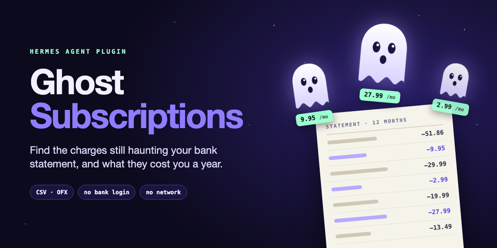
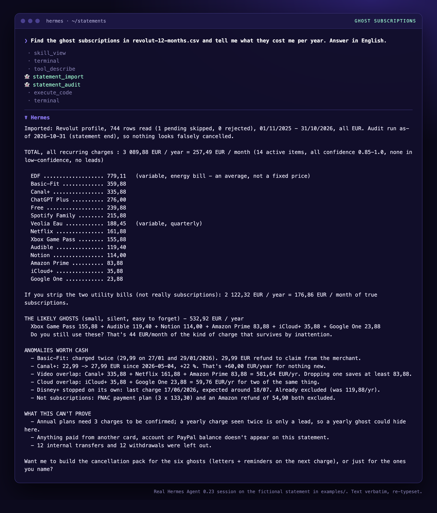
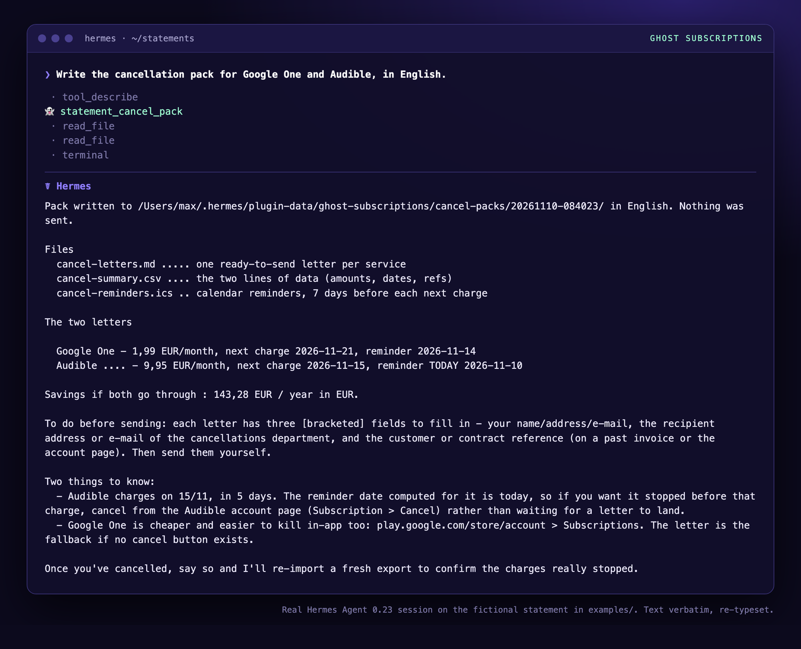
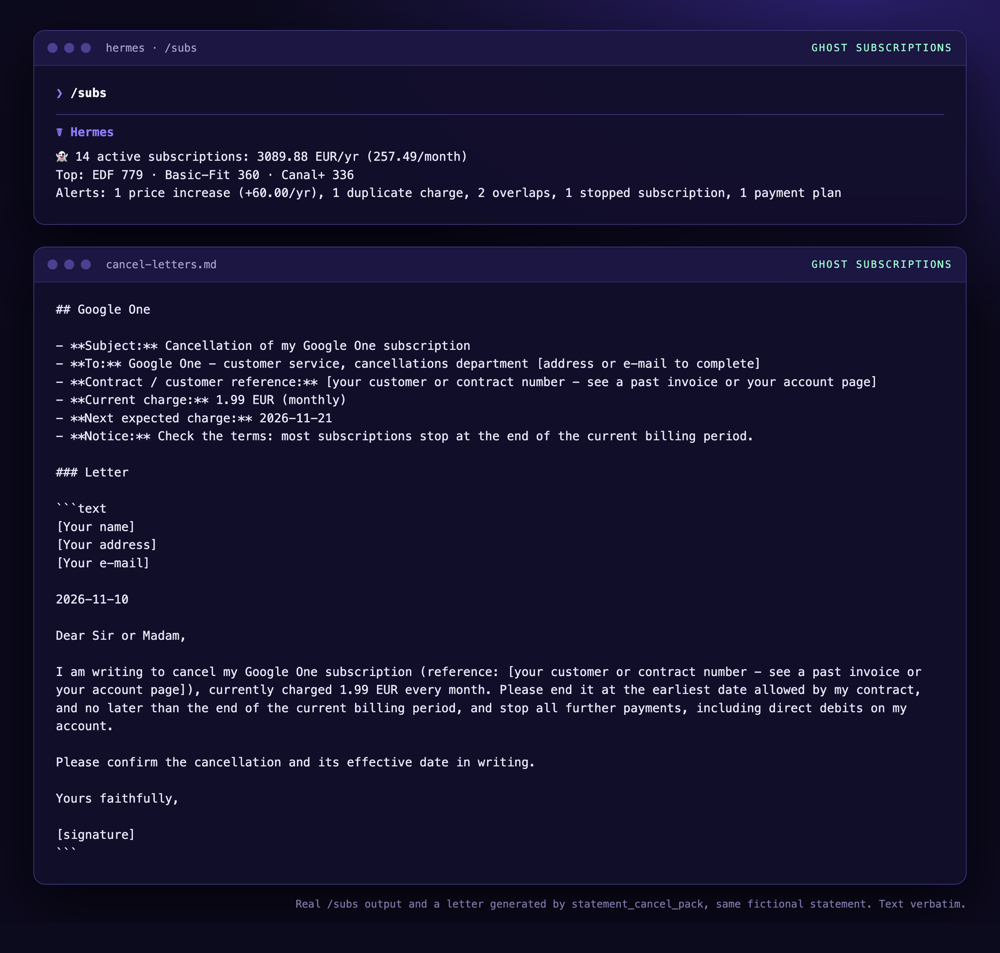

# 👻 Ghost Subscriptions

**Ghost subscriptions are the charges that keep haunting your bank statement long after you forgot them.
This plugin finds every one of them.**
Then see what they cost per year, what went up, what is billed twice, and get a ready-to-send
cancellation pack to bust the ones you no longer want.

A [Hermes Agent](https://github.com/NousResearch/hermes-agent) plugin. No typing your subscriptions in, no bank login,
no API key, no network: you hand it the CSV or OFX file your bank already lets you download.

```
/subs
👻 14 active subscriptions: 3089.88 EUR/yr (257.49/month)
Top: EDF 779 · Basic-Fit 360 · Canal+ 336
Alerts: 1 price increase (+60.00/yr), 1 duplicate charge, 2 overlaps, 1 stopped subscription, 1 payment plan
```

## Why another subscription plugin?

Because the catalog had none that **reads your statement**:

| | Where the data comes from | What it does |
|---|---|---|
| [`subscription-sheriff`](https://hermes-agent.nousresearch.com/docs/plugins/subscription-sheriff) | You type each subscription in plain English | Registry and renewal reminders |
| [`hermes-finance`](https://hermes-agent.nousresearch.com/docs/plugins/hermes-finance) | A separate finance app with Plaid bank sync | Full personal-finance database |
| **`ghost-subscriptions`** | **The CSV/OFX export from your bank, nothing else** | **Automatic detection of recurring charges, price increases, duplicates, overlaps, plus a cancellation pack** |

It is not a fork of either: a different engine on a different source. The point is the subscriptions you
would never think of typing in: the €9.95 audiobook plan, the second cloud storage, the gym that charged
twice in January. It is also the only one that produces cancellation letters.

## What it finds

On the 12-month synthetic statement in [`examples/`](examples/) (a fictional person, fictional numbers):

| Service | Every | Amount | Last charge | Per year | Confidence | Status |
|---|---|---|---|---:|---:|---|
| EDF | month | variable | 51.86 | 779.11 | 0.94 | active |
| Basic-Fit | month | fixed | 29.99 | 359.88 | 1.00 | active |
| Canal+ | month | fixed | 27.99 | 335.88 | 0.99 | active |
| ChatGPT Plus | month | fixed | 23.00 | 276.00 | 0.99 | active |
| Free | month | fixed | 19.99 | 239.88 | 1.00 | active |
| Spotify Family | month | fixed | 17.99 | 215.88 | 0.99 | active |
| Veolia Eau | quarter | variable | 45.50 | 188.45 | 0.85 | active |
| Netflix | month | fixed | 13.49 | 161.88 | 0.99 | active |
| Xbox Game Pass | month | fixed | 12.99 | 155.88 | 0.99 | active |
| Audible | month | fixed | 9.95 | 119.40 | 1.00 | active |
| Notion | month | fixed | 9.50 | 114.00 | 0.99 | active |
| Amazon Prime | month | fixed | 6.99 | 83.88 | 0.99 | active |
| iCloud+ | month | fixed | 2.99 | 35.88 | 0.99 | active |
| Google One | month | fixed | 1.99 | 23.88 | 0.99 | active |
| Disney+ | month | fixed | 9.99 | 0.00 | 0.99 | probably cancelled |

And the alerts:

- **Duplicate charge**: Basic-Fit 29.99 EUR on 2026-01-27 and again on 2026-01-29.
- **Price increase**: Canal+ 22.99 → 27.99 EUR since 2026-05-04 (+22 %, **+60.00 EUR a year**).
- **Overlap**: iCloud+ and Google One are both cloud storage; Canal+, Netflix and Prime are all video. Shown as a choice, not an error.
- **Stopped**: Disney+ has not charged since June: left out of the yearly total.
- **Refund neutralised**: an Amazon order refunded two weeks later.
- **Payment plan, not a subscription**: three FNAC payments of 133.30 EUR.
- **Left out**: 12 transfers to the person's own savings account, 12 cash withdrawals.

## See it in a real session

Real Hermes Agent 0.23 sessions on the fictional statement in [`examples/`](examples/). The text is verbatim;
it was re-typeset from the exported session so the pictures stay readable.

| Hunting the ghosts | Busting two of them |
|---|---|
| [](assets/screenshot-audit.png) | [](assets/screenshot-cancel-pack.png) |

[](assets/screenshot-subs-letter.png)

## Install

From the Hermes plugin catalog, once the entry is listed (the reviewed, pinned commit):

```bash
hermes plugins install ghost-subscriptions
```

Straight from this repository, today (Hermes warns that the source is not from the catalog):

```bash
hermes plugins install Max35j/ghost-subscriptions --enable
```

Requires Hermes 0.21.5 or newer. No Python dependency beyond the standard library.

## Use it

Just talk to your agent:

> I downloaded my bank transactions to ~/Downloads/export.csv. What subscriptions am I paying for?

> Did any of them go up this year?

> Write the cancellation letters for Audible and Google One.

> /subs

The agent calls four tools:

| Tool | When the agent uses it |
|---|---|
| `statement_import` | You give it a CSV/OFX file. Detects the bank format, reports rows read, skipped and rejected with reasons. Re-importing an overlapping export does not duplicate anything. |
| `statement_audit` | You ask what you pay for. Returns stable JSON: totals per currency, every subscription with its confidence, top 10, anomalies, warnings. |
| `statement_cancel_pack` | You decide to cancel. Writes `cancel-summary.csv`, `cancel-letters.md` (one letter per subscription, English or French) and `cancel-reminders.ics` (a reminder 7 days before each next charge). **Sends nothing.** |
| `statement_purge` | You ask to delete your data. Wipes everything the plugin stored, after you confirm. |

Plus a `/subs` slash command (three-line summary) and a bundled skill,
`ghost-subscriptions:monthly-audit`, that teaches the agent how to run a monthly review, read the confidence
scores and state the limits honestly.

## Supported banks

Profiles are plain JSON files in [`profiles/`](profiles/): delimiter, encoding, rows to skip, date format,
decimal separator, sign convention and column names. The format is detected by trying each profile.

| Country | Banks |
|---|---|
| France | BNP Paribas, Société Générale, Crédit Agricole, Boursobank, La Banque Postale, LCL, Caisse d'Épargne, Qonto |
| Europe | Revolut, N26, Wise |
| UK | Monzo, Starling |
| US | Chase, Bank of America, Capital One, American Express (purchases are positive amounts in its export; the profile flips the sign) |
| Any | OFX 1.x (SGML) and 2.x (XML), and any CSV with recognisable column names (`Date`, `Description`, `Amount`, `Debit`/`Credit`...) |

Bank export layouts change without notice. The profiles were written from the banks' documented or commonly
observed export formats, not from live exports of every bank. If yours is not recognised, the import tells you
the columns it found; set `column_mapping` (below) and import again with `profile="custom"`. A pull request
with a new profile is a 20-line JSON file.

The American Express profile rests on its documented sign convention (purchases positive, payments negative)
and on column names reported by third-party converters; it has not been checked against a live export. A file
with plain `Date, Description, Amount` columns is read as the generic layout, and the import warns when nearly
every amount is positive.

## How detection works

Everything below is plain Python in [`engine/`](engine/), tested without Hermes.

**1. Clean the description.** `PRLV SEPA SPOTIFY AB ECH/111126 ID EMETTEUR/FR12ZZZ…`, `CB SPOTIFY P1234ABCD 03/10`
and `Spotify France` all become `spotify`:

1. Unicode decomposition, accents removed, upper case;
2. transaction-type prefixes removed (CB, PRLV SEPA, VIR, CARD PAYMENT TO, DIRECT DEBIT, ATM…);
3. dates, times, masked card numbers, store numbers, 3+ digit codes, SEPA reference tails and country suffixes removed;
4. punctuation and repeated spaces removed;
5. matched against [`data/aliases.json`](data/aliases.json) (290 aliases for 134 services); a specific service beats a
   generic billing name (`APPLE.COM/BILL ICLOUD` → iCloud, not Apple);
6. unknown merchants keep their cleaned name, with 10 % lower confidence.

**2. Find the rhythm.** Per merchant, debits only: intervals between charges, their median *m* and median
absolute deviation *mad*. Weekly if *m* is 5-9 days, monthly 26-35, quarterly 80-100, yearly 350-380; anything
else is not concluded. Interval regularity = max(0, 1 − *mad*/*m*), at least 0.6 for monthly, 0.5 otherwise.
Three charges make a subscription; two only a *lead*.

**3. Score it.**

```
confidence = 0.4 × min(occurrences, 6)/6 + 0.4 × interval regularity + 0.2 × amount regularity
```

Amounts varying by less than 5 % (coefficient of variation) are *fixed*; above, the charge is a *variable* bill
(energy, water, phone usage) and is always labelled as such. Below the threshold (0.6 by default) a charge is
listed as *low confidence*, never counted.

**4. Look for trouble.**

| Alert | Rule |
|---|---|
| Price increase | Last charge vs the median of the six before: +3 % **and** +0.50. Also a step between two stable price levels (6 × 9.99 then 6 × 12.99). Yearly impact computed. |
| Duplicate | Same merchant, amount within 1 %, under 4 days apart, on a recurring charge. |
| Overlap | Two active services of the same family (video, music, cloud, VPN, AI assistant, gym…). |
| Stopped | Today is more than 10 days past the expected next charge: *probably cancelled*, out of the total. |
| Refund | A credit from the same merchant within 45 days, close amount: both left out. |
| Internal transfer | Debit/credit transfer pair of the same amount within 3 days, or your own name (`holder_aliases`). Left out and counted. |
| Payment plan | Three identical payments within 90 days with no rhythm, or a `3X` / `1/3` marker: not a subscription. |

**5. Add up.** Monthly × 12, weekly × 52, quarterly × 4, yearly × 1, in the original currency. Several currencies
are reported side by side and never converted unless you give rates.

## Settings

Set in the Desktop plugin settings or `config.yaml` under `plugins.entries.ghost-subscriptions.settings`:

| Key | Default | Meaning |
|---|---|---|
| `confidence_threshold` | `0.6` | Below it, a recurring charge is listed as low confidence. |
| `language` | `en` | `en` or `fr`: `/subs` and the cancellation letters. |
| `holder_aliases` | `[]` | How your name appears on transfers between your own accounts. |
| `holder_name` | `""` | Signature for the letters. |
| `column_mapping` | `{}` | Fallback for unknown CSV layouts: `{"date": "...", "label": "...", "amount": "..."}`, or `debit`/`credit`, plus optional `delimiter`, `date_format`, `decimal`, `sign`, `currency`. |
| `fx_rates` | `{}` | e.g. `{"base": "EUR", "USD": 0.92}` to add currencies up. |
| `contract_refs` | `{}` | Customer numbers per subscription id for the letters. |

## Privacy

- **No network.** The plugin imports no networking module and makes no request. A test checks it.
- **Local storage only**, in Hermes' per-plugin data folder (`<HERMES_HOME>/plugin-data/ghost-subscriptions/`).
- **IBANs are masked** to their last four characters, **full card numbers are removed** before anything is
  stored (Luhn check), account numbers from OFX files are kept as `****1234`.
- **The path of your statement file is never stored**, only a hash of its content to recognise a re-import.
- **`statement_purge` deletes everything**: transactions, import history and generated packs.
- No telemetry, no background process, no self-update, no credentials.

## Disclosure

- **Reads** the statement file you point it to (anywhere you choose, since that is where your download lands).
  It reads no other file outside its own install folder and data folder.
- **Writes** only to its data folder: a SQLite database and the cancellation packs you ask for.
- **Network**: none.
- **Shell commands, background processes, stored credentials, telemetry**: none.
- **Cancels nothing and sends nothing**: the letters are files you review and send yourself.

## Limits

- Yearly subscriptions need three charges, so more than two years of history, to be confirmed.
- What you pay with another card, account or PayPal balance is not on this statement.
- Notice periods and recipients in the letters are generic: check your contract and fill in the bracketed fields.
- Detection is statistical: low-confidence items are suggestions to check, not facts.

## Development

```bash
python -m pytest tests                 # 115 tests, no Hermes needed
python examples/generate_example.py    # rebuild the synthetic demo statement
hermes plugins validate . --install-deps
hermes plugins doctor .
```

Layout: `plugin.yaml` (manifest), `__init__.py` (`register(ctx)`), `schemas.py` (tool schemas),
`engine/` (parsing, normalisation, detection, pack, storage: pure and testable), `profiles/`, `data/`,
`skill/SKILL.md`, `examples/`, `tests/`.

## License

MIT, see [LICENSE](LICENSE).
